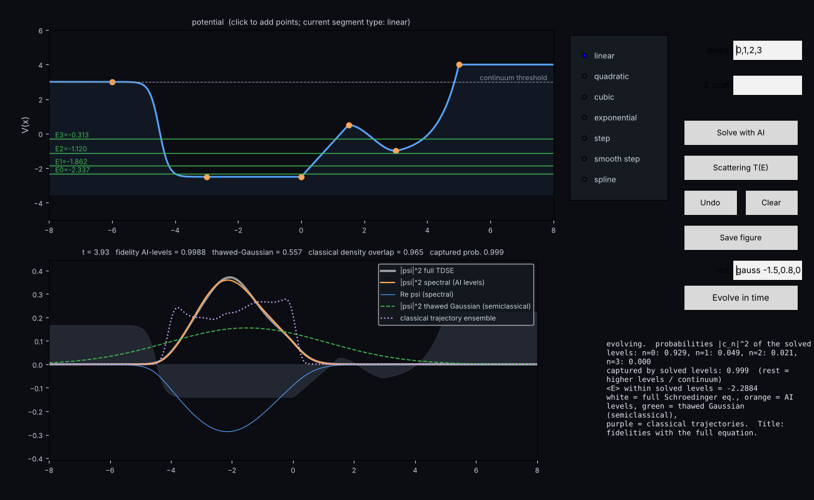
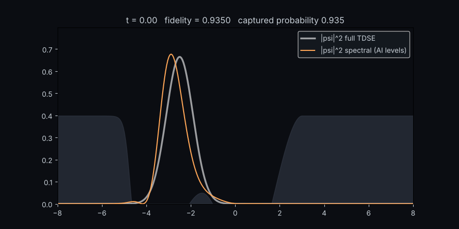

# AI Schrödinger solver — draw a potential, let a neural network find its quantum states

You click a potential energy curve into the upper panel; a small neural network (plain NumPy, no
deep-learning framework) finds the bound states by minimising the energy, live, while the exact
numerical answer is computed alongside for comparison. Then drop a wave packet in and watch it move,
with the AI's prediction, the full time-dependent Schrödinger equation and two semiclassical
approximations side by side.

## Run it (2 minutes)

1. Install Python 3.10 or newer from <https://www.python.org/downloads/> (on Windows tick
   *Add python to PATH* in the installer).
2. Download this repository (green **Code** button → *Download ZIP*, then unzip) or `git clone` it.
3. Start it:
   * **Windows:** double-click `run.bat`.
   * **macOS / Linux:** open a terminal in the folder and run `./run.sh`.

   The first start installs three libraries (numpy, scipy, matplotlib, ~60 MB) and opens the window.
   After that you can also open a terminal in the `program` folder and run `python run_me.py`.

Nothing else is needed: the trained model (`program/pretrained_model.npz`) is included.

## Using the window

| Control | What it does |
| --- | --- |
| Click in the upper panel | Adds an anchor point (left to right). Pick the segment type in the list *before* the next click: linear, quadratic, cubic, exponential, step, smooth step, spline. Left and right of the last points the potential is flat. |
| `levels` | Which states to solve, e.g. `0,1,2` (0 = ground state). |
| `stable s` | How long (seconds) a wave function must hold still before its level is accepted. Default 15; lower is faster, higher is stricter. |
| `psi tol` | The stability threshold: the wave function counts as still when its change, median ∫(ψ − ψ̄)² dx over the last checks, is below this. Default 1e-6; converged states sit at 1e-9 to 1e-12, so raise it (e.g. 1e-5) for faster, looser acceptance or lower it for stricter. |
| **Solve with AI** | The network predicts each wave function, then refines it variationally. The lower panel shows it converging (pink) onto the exact one (grey). A level is accepted once its wave function has stayed stable for `stable s` seconds; a hard limit (90 s or 4× that) per level is the backstop. The panel then lists AI, exact and WKB energies. |
| **Scattering T(E)** | For energies above the continuum threshold (dashed line): the scattering wave, the transmission curve and its resonance peaks. `E scat` picks the energy; empty = the strongest resonance. |
| `init` + **Evolve in time** | Initial state as `gauss x0,sigma,k0` (a wave packet) or `0:1,1:1` (a mix of solved levels). White = full Schrödinger equation (reference), orange = AI levels, green dashed = thawed Gaussian (semiclassical), purple dotted = classical trajectories. The title shows each method's fidelity with the reference. |
| **Auto-learn** | Keeps training the stored model in a background thread on random potentials and on the ones you draw; new weights are kept only if a held-out test does not get worse. It pauses by itself while you solve or evolve. Toggle it off to free the CPU. |
| **Create GIF** | Appears while an evolution runs: writes an animated GIF of the potential and the evolution from its start until the moment you press (saved in the `GIF` folder next to this README as `evolution_<date>.gif`); the evolution keeps running, so press again for a longer one. |
| **Undo / Clear / Save figure** | Clear always works, also during solving or evolution. Save writes `my_potential.png`. |

A bound state needs an energy below *both* ends of the potential. If the panel says none of the
requested levels is bound, raise the ends of your drawing or deepen the well.

## What is in the repository

Everything at the top level is meant to be read or clicked; `program/` holds the code and data the
launchers use, which you never need to open.

| File | Purpose |
| --- | --- |
| `README.md` | This guide. |
| `run.bat`, `run.sh` | Launchers (Windows / macOS and Linux). |
| `THEORY.md` | The physics and the machine learning in detail, with references. |
| `PROBLEMS_AND_SOLUTIONS.md` | Every problem met during development, its cause and its fix. |
| `docs/` | The screenshot and the animation shown above. |
| `GIF/` | Created on first use: the GIFs you record with **Create GIF**. |
| `LICENSE` | MIT. |
| `program/run_me.py` | The window (matplotlib). |
| `program/qm_model.py` | The network, the variational optimiser with the stability stopping rule, exact grid reference, WKB, scattering, time propagators. |
| `program/pretrained_model.npz` | Trained weights (pre-trained on 1,600 random potentials). Auto-learn updates it in place. |
| `program/train_pretrained.py` | Rebuilds the weights from scratch (~4 minutes). Optional. |
| `program/continual.py` | The background learner behind Auto-learn. |
| `program/app_gradio.py` | Browser version for a Hugging Face Space (`pip install -r requirements_space.txt`, then `python app_gradio.py`, both inside `program`). |
| `program/requirements.txt` | The three libraries the launchers install. |
| `program/solver_log.txt` | Written while the app runs: timings and any error, useful when reporting a problem. |

## How it works, in one paragraph

The network takes the position x, the level index n and a 32-point sample of the drawn potential and
outputs ψ(x). It is first trained on exact solutions of random potentials, then, for your potential, its
weights are tuned by gradient descent on the energy ⟨ψ|H|ψ⟩/⟨ψ|ψ⟩, which by the variational principle can
only overshoot the true energy, so every decrease is real progress. Excited states are found the same way
after projecting out the lower ones. "Exact" means an exact diagonalisation of the same 320-point grid
Hamiltonian (tridiagonal, direct), so the AI error measures how well the network solves the discretised
problem; the grid itself is accurate to roughly 1e-4 in energy, worse near hard steps. Units: ħ = m = 1,
box x ∈ [−8, 8].

## Troubleshooting

* *The window does not open / an error appears in the terminal:* make sure `python --version` reports
  3.10 or newer and, in the `program` folder, run `python -m pip install -r requirements.txt` by hand.
* *Solving seems slow:* turn Auto-learn off, or lower `stable s`. Each level needs at least `stable s`
  seconds by design (the stability hold); three levels at the default 15 take about 50 s.
* *Something failed:* the status panel shows the error and `program/solver_log.txt` has the details.

## License

MIT, see `LICENSE`.
