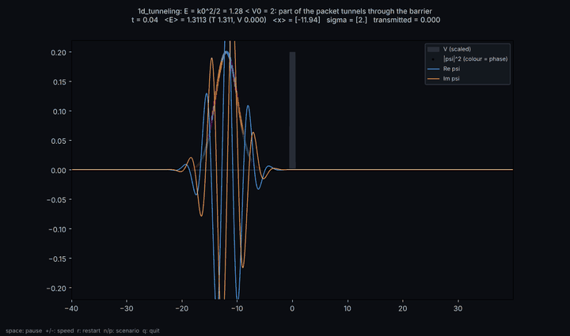
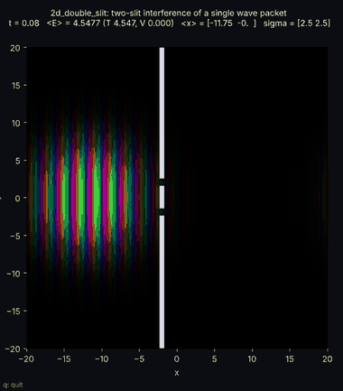
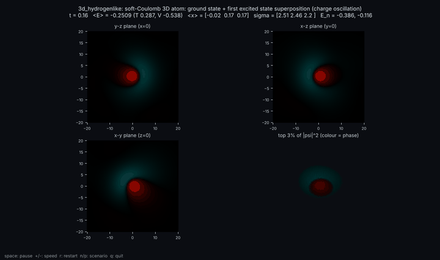

# qm_wavefunctions — wave functions in 1D, 2D and 3D over time

| 1D: tunnelling through a barrier | 2D: double-slit interference | 3D: hydrogen-like atom, charge oscillation |
| --- | --- | --- |
|  |  |  |

Made with `python run_wavefunction.py --scenario <name> --save docs/<name>.gif --frames 120`.

Interactive time-dependent Schrödinger equation (split-operator method), phase-coloured amplitude,
eleven textbook scenarios.  Physics and references: `THEORY.md`.

## What to install (once)

1. Python 3.10–3.12 from https://www.python.org/downloads/ (Windows: tick "Add python to PATH").
2. In this folder open a terminal (Windows: shift + right-click → "Open PowerShell window here") and run

       pip install -r requirements.txt

   That installs numpy, scipy, matplotlib and pillow (~100 MB total, no Qt/OpenGL needed).

## Run

    python run_wavefunction.py --list                     # scenarios and what they show
    python run_wavefunction.py                            # 1D tunnelling (default)
    python run_wavefunction.py --scenario 2d_double_slit
    python run_wavefunction.py --scenario 3d_hydrogenlike # prepares eigenstates first (~20 s), then animates
    python run_wavefunction.py --scenario 1d_double_well --save well.gif --frames 300   # movie, no window

Keys in the window: **space** pause/run · **+ / −** faster/slower · **r** restart · **n / p** next/previous
scenario · **q** quit.

## Reading the picture

* 1D: |ψ|² as dots coloured by the phase of ψ, Re ψ (blue) and Im ψ (orange), potential in grey.
* 2D: brightness = |ψ|, hue = phase.  A moving packet is a rainbow whose stripe spacing is the de Broglie
  wavelength; interference shows up as fringes.  Walls are white.
* 3D: three mid-plane slices plus a rotating point cloud of the densest 3 % of voxels.
* Title line: time, ⟨E⟩ (kinetic + potential), ⟨x⟩, width, eigen-energies / tunnel period / transmission.

## Files

    schrodinger.py        grid, potentials, split-operator solver, imaginary-time eigenstates, scenarios
    run_wavefunction.py   animation / interaction / movie export
    THEORY.md             article-style description of the physics and the numerics
    requirements.txt

## Modify

Add a potential to `POTENTIALS`, an initial state, or a `SCENARIOS` entry (dimension, grid, box, dt,
potential, initial state) in `schrodinger.py` — nothing else needs to change.  Ideas: a time-dependent
field (multiply `_expV_half` each step), two particles in 1D (use dim=2 with V(x₁, x₂)), absorbing
boundaries (multiply ψ by a mask near the edges), a magnetic field in 2D (Peierls phase on the kinetic
step).
