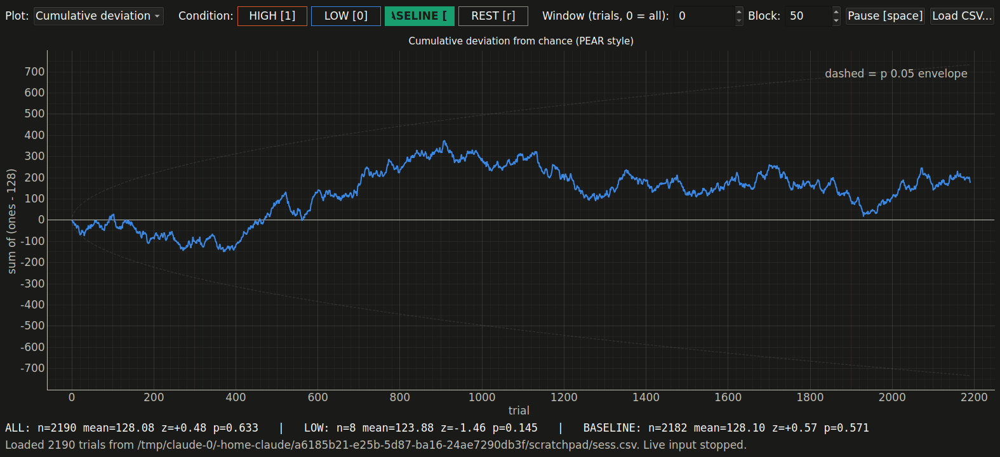
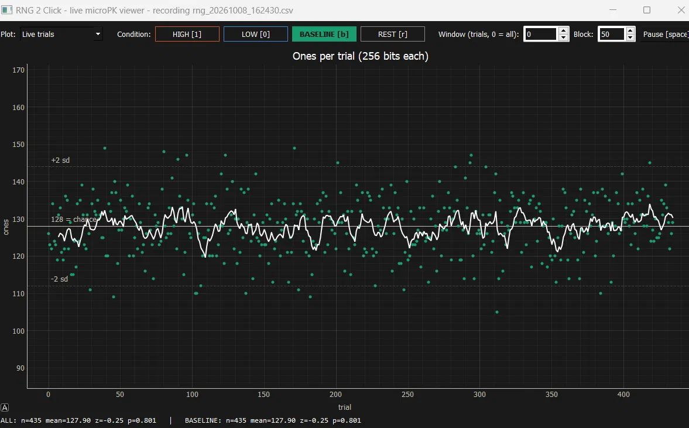
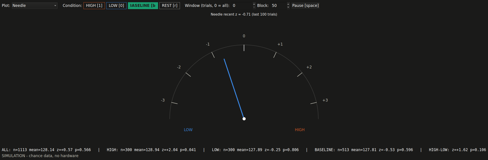

# rng_live_viewer — real-time plots for a micro-PK experiment with a hardware random number generator

A PyQt/pyqtgraph viewer for the **RNG 2 Click** quantum-noise random number generator. Every sample from
the board is 32 bytes = 256 bits; under chance the number of 1-bits per sample is Binomial(256, 0.5),
mean 128, sd 8. One sample is one trial. The viewer tags trials with the subject's intention
(HIGH / LOW / BASELINE / REST), records every session to CSV, and shows the standard
PEAR / Global Consciousness Project statistics live.







## Install and run

```
python -m pip install pyserial pyqtgraph PyQt5 numpy
python rng_live_viewer.py            # auto-detects the USB UART port
python rng_live_viewer.py COM5       # or name the port
python rng_live_viewer.py --sim      # no hardware: simulated chance data
python rng_live_viewer.py --load rng_20261008_162430.csv   # open an old session, no hardware
```

Close any other program that holds the serial port first (only one can). Every run writes
`rng_YYYYMMDD_HHMMSS.csv` in this folder; `--no-record` skips it. The `.csv` files in this folder are real
sessions from the rig; `ingen interaksjon.csv` ("no interaction") is a long unattended baseline.

## Controls

| Control | Meaning |
| --- | --- |
| Plot selector | Live trials · Cumulative deviation (PEAR random walk with the p = 0.05 parabola) · By condition (HIGH / LOW / BASELINE walks overlaid, "tripolar") · Running z · Histogram vs binomial · Variance deviation (GCP netvar style) · Block z · Bit bias (hardware sanity check) · Needle · Tug of war |
| Condition buttons, keys `1` `0` `b` `r` | Tag the trials HIGH / LOW / BASELINE / REST |
| Window | 0 = all trials; e.g. 500 = only the last 500 |
| Block | Trials per block for the Block-z plot |
| Space | Pause drawing (recording continues) |
| Load CSV… | Open a recorded session; all plots work on it |

## A caution, illustrated by the simulator

In a chance-only run of about 1,000 simulated trials the HIGH condition came out at z = +2.04 (p = 0.04).
With several conditions and ten plots, something will look "significant" by luck. The number that
matters is HIGH − LOW over many sessions, with the sample size and the statistic decided on in advance.

## Files

`rng_live_viewer.py` — the viewer · `README.txt` — the original plain-text notes ·
`rng_*.csv`, `test*.csv`, `ingen interaksjon.csv` — recorded sessions · `real_Running_z.png` — a running-z
screenshot from the hardware · `docs/` — the screenshots above.
