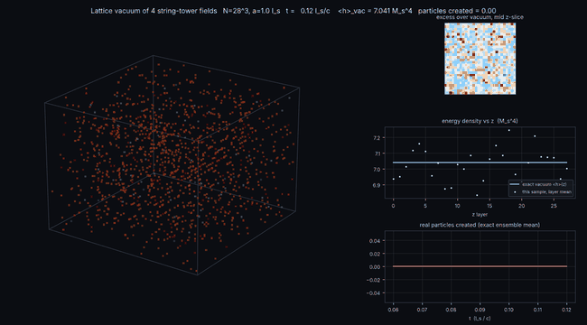

# vacuum_sim — an exact, interactive 3D simulation of quantum-vacuum fluctuations

A small local program (Python) that samples the quantum vacuum of a set of free fields taken
from the string spectrum, evolves it in real time on a 3D lattice, renders the fluctuating
energy density as a volume you can fly through, and lets you disturb the vacuum in the ways that
really turn fluctuations into particles: Casimir mirrors, a Schwinger electric field, and mass
quenches — with exact particle-number bookkeeping and the supersymmetric cancellation of the
mean vacuum energy shown side by side.

Nothing in the physics core is approximated beyond the lattice regularisation itself: a free
field's vacuum is Gaussian, and Gaussian states evolve exactly under quadratic Hamiltonians
(`derivations/01`).  The Standard Model is *not* simulated (it cannot be, see below); what is
simulated is the exactly solvable piece that every quantum field theory, string theory included,
contains.

## 1. Install (Windows, macOS, Linux)

1. Install Python 3.10–3.12 from python.org (tick "Add python to PATH" on Windows).
2. Open a terminal in this folder (Windows: shift-right-click the folder → "Open PowerShell
   window here") and run

       pip install -r requirements.txt

   This pulls numpy, scipy, PySide6 (Qt, ~150 MB — the only large dependency), pyqtgraph and
   PyOpenGL.  Nothing else is written to disk; the program itself is ~150 kB.
3. Check the physics (no window needed, ~1 min):

       python run.py --selftest

4. Start:

       python run.py                # 32^3 lattice, ~20–30 fps on a laptop
       python run.py --N 48         # finer, slower (cost ~ N^3)
       python run.py --N 24 --a 0.7 # faster, finer spacing (smaller box)

If the window does not open (no OpenGL driver, remote desktop, very old GPU), you can still render
movies: `python run_headless.py` writes `vacuum_demo.gif` with matplotlib only
(`--scenario quench|schwinger|casimir|tour`, `--out movie.mp4` if ffmpeg is installed).

Tested: the physics core and the headless renderer were run and validated on Linux; the Qt GUI
was exercised against a mock of the Qt/pyqtgraph API but could not be opened on the build machine
(no display / no PyPI access there), so if anything in the window misbehaves, the error is shown
in the status bar and printed in the terminal — send it back and it is a small fix.

## 2. Controls

| input | action |
|---|---|
| left mouse drag | rotate (orbit) the cube |
| mouse wheel | zoom |
| middle drag or Ctrl + left drag | pan |
| **W / S** | fly forward / backward along the view direction |
| **A / D** | strafe left / right |
| **E / Q** | fly up / down |
| Shift / Alt | fly 4× faster / slower |
| R | reset camera |
| arrow keys | orbit in steps |

The control panel sits to the right of the volume (never on top of it); drag the divider to
resize.  Everything in the panel acts immediately on the running simulation.

## 3. What you are looking at

* **Vacuum energy density h(x,t)** (default): the classical energy density of one exact sample
  of the vacuum state, summed over the fields ticked under "fields shown".  Bright = high.  It
  averages to the zero-point density ⟨h⟩_vac = (1/V)Σ ½ω shown in the panel, and it boils
  because every mode oscillates at its own frequency.
* **Field amplitude φ(x,t)**: the signed field, diverging colour map.
* **Excess over vacuum h − ⟨h⟩_vac**: zero on average for the undisturbed vacuum; after a quench,
  a pulse or a plate insertion its spatial mean is the energy density of the real particles
  created.  The exact number of particles is in the panel and in the history plot — a single
  history cannot label individual voxels as "particle" or "fluctuation" (`derivations/07`).
* **Probe resolution σ**: Gaussian smoothing = what a detector of size σ sees.  σ = 0 shows the
  raw lattice (white-noise-like, because vacuum fluctuations are dominated by the shortest
  resolved scale); σ ≈ 1–2 reveals the slower, longer-wavelength structure.
* Modes: volume (slice-stack), single slice, isosurface.

## 4. Experiments

**Casimir mirrors** — two perfect plates (φ = 0).  Between them the mode spectrum is discrete,
the zero-point energy depends on the separation d and −dE/dd is the Casimir force.  The panel
compares the lattice result with −π²/(1440 d³) per area (massless) and the K₂ formula (massive),
in string units and in newtons, and plots the exact energy-density profile ⟨h⟩(z).  The sudden
insertion itself creates particles (dynamical Casimir effect); the exact number is logged.

**Electric field (Schwinger effect)** — a uniform field pulse along x acts on the charged scalar.
Each Fourier mode becomes a parametric oscillator; sweeping through zero kinetic momentum creates
particle–antiparticle pairs with the exact Sauter probability e^{−π m⊥²/eE}, and the panel shows
the Schwinger rate, the critical field m²/e, the pulse-length limit that keeps the lattice result
identical to the continuum, and the exact pair count.  Try E0 below and above m²/e.

**Mass quench / ramp** — change a field's mass instantly (exact Bogoliubov result
n_k = (ω₁−ω₀)²/4ω₀ω₁, quoted in the log as a prediction before the button acts) or over a ramp
time: the adiabatic theorem makes the particle number collapse as the ramp gets slower.
Quench back and the occupations do not simply add: each mode returns to zero if the second quench comes at ω₁τ = nπ, so the total oscillates with the waiting time (the Bogoliubov map is invertible; quenching straight back gives zero).

**Supersymmetry** — tick the box to add the fermionic superpartners of every sampled field to the
mean-energy bookkeeping, Σ(−1)^F g ½ω (Vol.1 eq. 7.3.24).  With M_susy = 0 the mean vacuum energy
cancels exactly, level by level, as it does in the superstring; with M_susy > 0 the quadratic
remainder appears.  The picture does not change: supersymmetry cancels the *mean*, not the
fluctuations (`derivations/06`).

**Temperature** — sample a thermal state instead of the vacuum (Bose–Einstein factor per mode).
Combined with the Unruh read-out this shows what an accelerated observer sees.

**Units** — choose the physical string length l_s; the panel converts grid spacing, time step,
energy density (J/m³, GeV⁴, ratio to the observed dark energy) and field strengths (V/m).
Polchinski's "52 orders of magnitude" (Vol.1 p.222) is computed live for comparison.

## 5. Physics in one paragraph (details in `derivations/`)

Fields: a massless neutral scalar, a light charged scalar (open-string U(1) sector) and the first
massive levels of the chosen string theory (masses m² = 4N/α′ for closed type II; degeneracies
from the light-cone partition functions, `spectrum.py`).  Each field is a lattice-regularised free
Klein–Gordon field; its vacuum is the product of oscillator ground states; a sample is drawn from
the ground-state Wigner function (variances ħ/2ω, ħω/2) and evolved by the exact mode rotation.
For quadratic Hamiltonians this is exact (Moyal bracket = Poisson bracket), so all symmetrically
ordered correlators, the zero-point energy ⟨h⟩ = Σ½ω/V (Vol.1 §7.3), and every linear
perturbation (time-dependent mass, external gauge field, sudden Dirichlet planes) are reproduced
exactly.  The ensemble covariance of every mode is propagated alongside the sample, giving
sampling-noise-free particle numbers n_k = (C_pp + ω²C_qq)/2ω − ½.  `tests/test_physics.py`
checks each of these statements against closed-form results.

## 6. Honest limitations

* The lattice spacing is a UV cutoff (Λ = π/a).  Absolute zero-point energies depend on it — as
  they must (that *is* the cosmological-constant problem).  Differences (Casimir), particle
  numbers and dimensionless ratios do not, up to O(a²) corrections that the panel lets you see by
  changing a.
* Perfect mirrors and sudden changes are idealisations.  After a second geometry change the
  ensemble numbers neglect inter-mode correlations (the picture stays exact).
* No back-reaction, no interactions, no gravity.  Real string theory's finite one-loop vacuum
  amplitude comes from modular invariance on the world-sheet (Vol.1 pp.219–220), which no
  spacetime lattice reproduces; here the tower is shown with Polchinski's proper-time cutoff
  "for rough insight" (p.220) and with the SUSY cancellation that the superstring actually uses.
* Bosonic-string theories contain a tachyon; it is listed and never sampled (Vol.1 p.219: an
  artefact of an inconsistent toy theory).

## 7. How to modify or extend (also marked `MODIFY:` in the code)

Cheap (an afternoon):
* **More or different fields** — `simulation.default_specs()` or pass your own `FieldSpec` list
  (mass, charge, multiplicity, colour).  Sample several copies of a level to see the 1/√g
  suppression of the summed fluctuations.
* **Thermal / squeezed / coherent initial states** — `FieldState.sample_vacuum()`; thermal is
  already there (temperature box).
* **Other boundary conditions** — Neumann plates = DCT-I instead of DST-I (`geometry.DirichletBlock`);
  a box with walls on all sides = DST along every axis.
* **A Sauter pulse or an oscillating field** — `perturbations.EFieldPulse.window()`.
* **Expanding universe** — make the lattice spacing a time dependent scale factor a(t) in
  `FieldState._omega` (ω_k = k/a(t)): cosmological particle creation, same Bogoliubov code.
* **Different colour maps / rendering** — `render.py`; a slice-density or ray-marching shader in
  `gui/view3d.py`.
* **New read-outs / plots** — `panel.py` + `main_window.py` callbacks (one dict).

Medium (a week):
* **Exact dynamical Casimir for a moving mirror** — time-dependent mode basis (Moore 1970);
  currently a move is two sudden changes.
* **Fermionic partner fields** — Wilson or staggered lattice fermions for ⟨ψ̄ψ⟩(x); note the
  doubling problem.  Their *energy* bookkeeping is already exact through (−1)^F.
* **Second charged species / different charges** — trivial in `FieldSpec`; a magnetic field needs
  Landau-level modes (a different block type).
* **Compact extra dimension** — add a 4th periodic axis of a few sites; its Kaluza–Klein tower
  appears automatically in ω_k and its Casimir energy is what the moduli potential of Vol.1 ch.8
  is made of.

Hard (research):
* **Interactions** (λφ⁴, gauge couplings) — the exactness is lost; the classical-statistical
  method is only valid for highly occupied modes, so you would need a genuinely quantum method
  (e.g. 2PI / Kadanoff–Baym, or tensor networks in lower dimension).
* **Back-reaction of created pairs on the electric field** — add Maxwell's equation for A_x(t)
  sourced by the exact current ⟨j_x⟩ from the mode covariances (Kluger–Mottola–Eisenberg 1998):
  plasma oscillations of the produced pairs.
* **Horizons** (Hawking / Unruh in real time) — a position-dependent metric; the Bogoliubov
  machinery survives, the FFT diagonalisation does not.

## 8. Files

    run.py                      interactive GUI entry point (also --selftest, --load)
    run_headless.py             matplotlib movie renderer (no Qt/OpenGL)
    requirements.txt
    vacuumsim/
      units.py                  natural units <-> SI, string-length presets, dark-energy density
      spectrum.py               string mass tower and degeneracies (4 theories)
      geometry.py               lattice, periodic FFT block, Dirichlet DST blocks, mixing matrices
      field.py                  vacuum sampling, exact evolution, energy density, covariance bookkeeping
      perturbations.py          mass ramps, electric-field pulses
      observables.py            closed-form reference results (Casimir, Schwinger, Coleman–Weinberg, ...)
      simulation.py             orchestration, read-outs, save/load
      render.py                 colour maps -> RGBA volumes
      gui/view3d.py             OpenGL view, mouse orbit, WASDEQ flying
      gui/panel.py              control / read-out panel
      gui/main_window.py        frame loop and callbacks
    tests/test_physics.py       13 validation tests against exact results
    derivations/                the maths, with page references to Polchinski Vol.1 / Vol.2

## 9. Save / load

"Save state" writes a compressed .npz (all mode amplitudes and covariances, ~10 MB at N = 32);
"Load state" or `python run.py --load file.npz` resumes exactly.  Random seed + settings alone
reproduce the *initial* vacuum but not the perturbation history, hence the full save.
